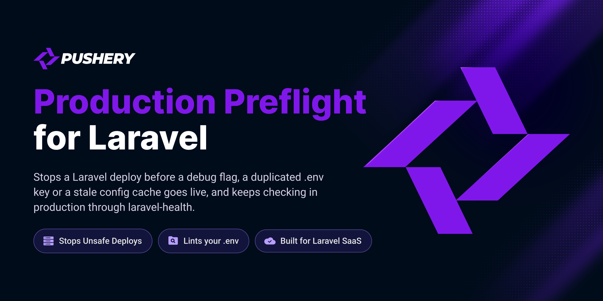

<p align="center">
  <a href="https://github.com/pushery/production-preflight-for-laravel">
    
  </a>
</p>

# Production Preflight for Laravel

[](https://packagist.org/packages/pushery/production-preflight-for-laravel)
[](https://packagist.org/packages/pushery/production-preflight-for-laravel)
[](https://packagist.org/packages/pushery/production-preflight-for-laravel)
[](LICENSE)

[](https://pestphp.com)


[](https://phpstan.org)
[](https://laravel.com/docs/pint)

Laravel production checks for what passes every test: unsafe settings, a .env that loads other values than it shows, and installs running on stale state.

## Documentation

**Full documentation at
[docs.pushery.com/production-preflight-for-laravel](https://docs.pushery.com/production-preflight-for-laravel/).**
This README is the quick start; the guides, the configuration reference and the
upgrade notes live there.

## Requirements

- PHP 8.4+
- Laravel 13+

Tested on PostgreSQL and MySQL 8.4, the databases Laravel Cloud runs (serverless Postgres
and MySQL 8.4 LTS), so it runs there out of the box. The fast suite runs on SQLite.

Tested on **PHP 8.4** — the floor of the declared range, because a `>=` promise is
only proven by running on the boundary — and on **PHP 8.5**, so the upper half of
`^8.4` is exercised here rather than first by a consumer.

## Installation

```bash
composer require pushery/production-preflight-for-laravel
```

The service provider is registered automatically through package discovery. The package builds on [laravel-health](https://spatie.be/docs/laravel-health), which Composer installs alongside.

## Usage

A misconfigured production application rarely fails: `APP_DEBUG=true` serves pages, `MAIL_MAILER=log` accepts every message, and a key set twice in `.env` is valid syntax. This package checks for those states in the deploy, so they never go live, and on a schedule, because half of them appear afterwards.

Stop a deploy on a finding. In the deploy script, with `set -e`, after `composer install` and `config:cache`:

```bash
php artisan preflight --deploy
```

It exits with 0 when no check failed, 1 when one did, and 2 when a check could not look. Warnings are printed and let the deploy through.

Report in operation through laravel-health, in the `boot` method of a service provider:

```php
use Pushery\ProductionPreflight\Preflight;
use Spatie\Health\Facades\Health;

Health::checks(Preflight::checks());
```

Lint a `.env` file on its own, in a pipeline or on a schedule:

```bash
php artisan env:lint .env.production
```

Twenty-seven checks cover the `.env` file (keys set twice, keys missing against the example, placeholders, a cut-off `#`), the configuration (debug mode, the application key, mail that goes nowhere, test-mode payment keys, queue, session and cache drivers) and the installation (a stale configuration cache, workers that missed `queue:restart`, pending migrations, exposed secrets). No check passes when it could not look, and no value of the application reaches a log, a notification or a stored result. The [documentation](https://docs.pushery.com/production-preflight-for-laravel/) lists every check and its verdict.

## Configuration

Publish the configuration file:

```bash
php artisan vendor:publish --tag=production-preflight-config
```

This writes `config/production-preflight.php`, where every option is documented inline. A check that does not fit an application is acknowledged there by its key, with the reason, which then stands in every report:

```php
'acknowledged' => [
    'queue-connection' => 'One person uses this installation; jobs run in the request on purpose.',
],
```

## Testing

The test suite is not part of the published package: the tests and their PHPUnit
configuration stay in the development repository, so a clone of this repository has no
`composer test`. [CONTRIBUTING.md](CONTRIBUTING.md) says how a change is tested on its way in.

## Security

Please review the [security policy](SECURITY.md) and report vulnerabilities
privately rather than opening a public issue.

## Built by Pushery

This package is built and maintained by [Pushery](https://www.pushery.com) — a
Berlin-based studio building Laravel applications, SaaS products, and open-source
tools.

Building a Laravel UI? [WireKit](https://www.wirekit.app) is Pushery's open-source
Livewire component kit.
Browse the rest of our work at [pushery.com](https://www.pushery.com).

## License

The MIT License (MIT). See [LICENSE](LICENSE) for details.
